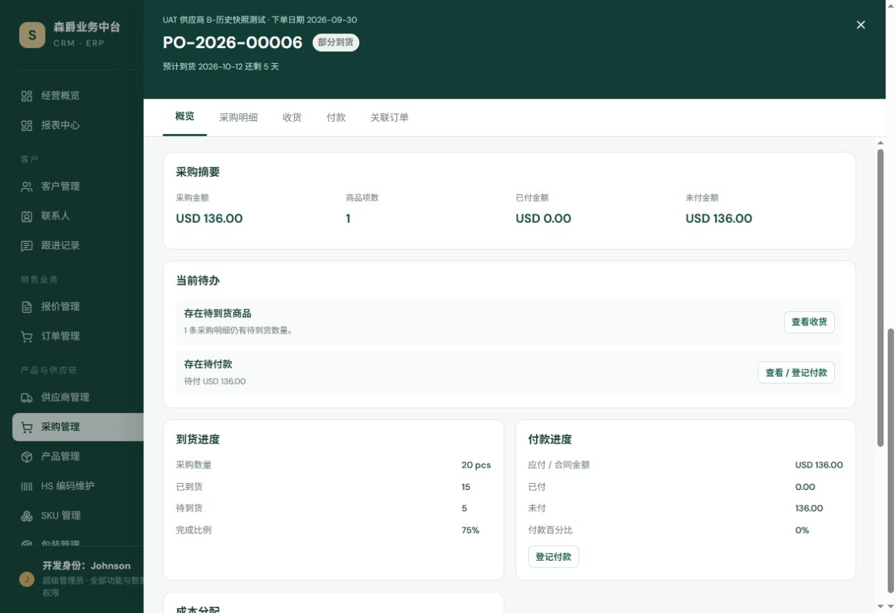
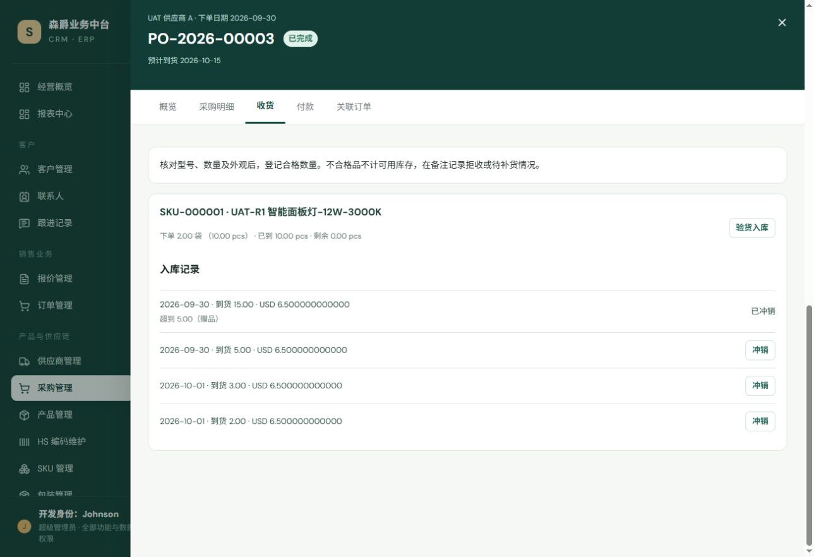
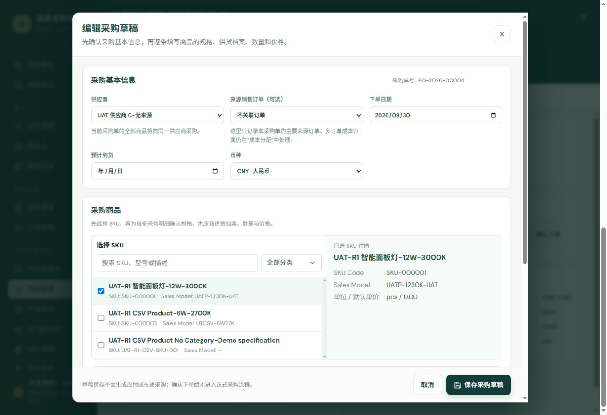
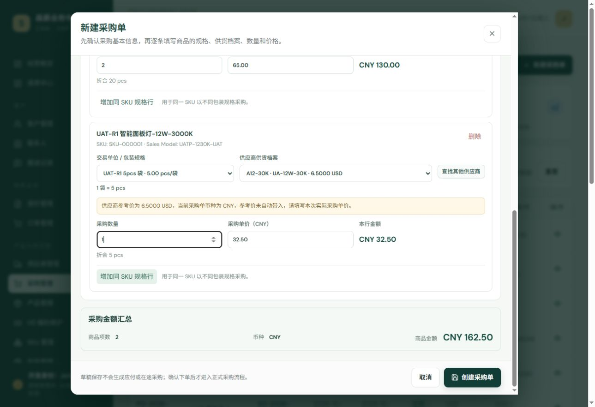
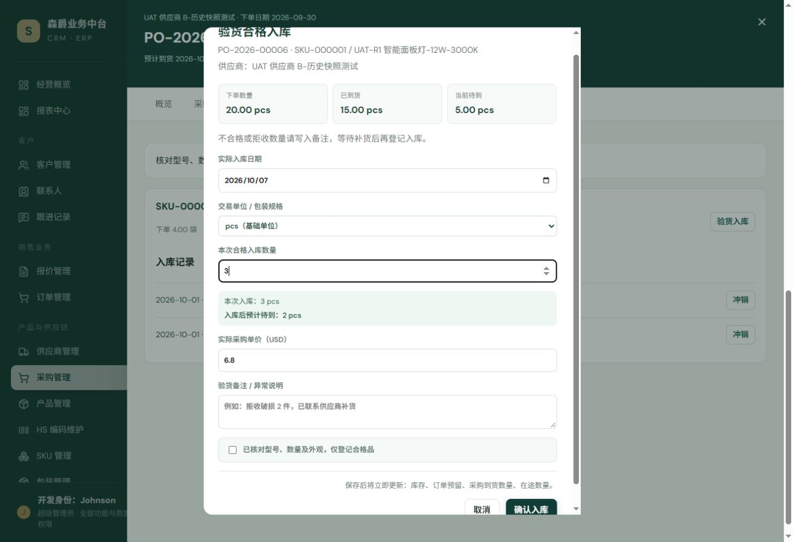
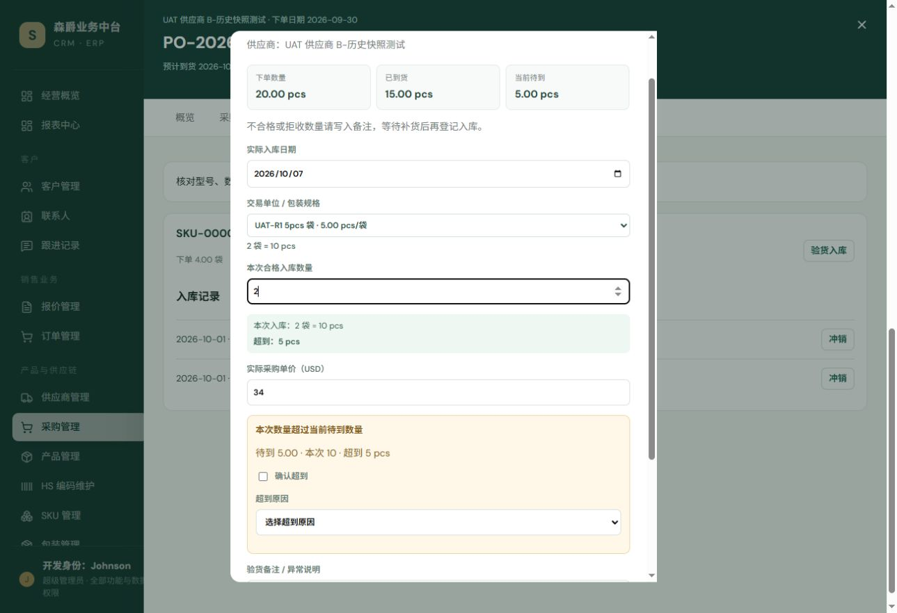

# 采购模块 UX Phase A：列表与正式采购工作台

日期：2026-10-07（Asia/Shanghai）。起点：`beeeb6fa3ce3d0359cafed6e438896e6e0c57fcd`，基线 CI #161 成功。

## 范围与验收状态

本次仅实施 Phase A；不标记采购模块 UX-FROZEN，不开展 Phase B。实现、自动化测试及真实 UI UAT 已完成。最终交付以提交后的 HEAD CI 三项结果为准；独立 ChatGPT 评审仍待外部完成，不能将本实现者自检算作独立评审。未修改后端、模型、迁移或开发超级管理员约定。

## 信息架构

旧列表展开行同时承担生命周期、关联订单、收货与冲销、付款、成本分配和合同调整，已经无法提供清晰的操作层级，也无法可靠承载筛选外深链接。

`frontend/src/components/PurchaseDetailModal.vue` 现在是唯一采购详情入口：右侧工作台宽 `min(1080px,100%)`，深绿头部，五个平级页签：概览、采购明细、收货、付款、关联订单。旧大型 `detail-row` 及列表外漂浮的合同金额调整已移除。列表整行支持点击与 Enter，行内来源订单链接和查看图标阻止点击冒泡。

页面保留列表、草稿编辑、路由和既有业务弹窗及变更函数。工作台通过事件传回原采购对象、精确 PurchaseItem 和历史 receipt；不复制后端流程。错误和 PCR-004 收货成功后的关联订单 CTA 通过工作台反馈插槽展示，避免被抽屉遮住。

## 路由语义

- 搜索：`search`，输入初始化自 URL，300ms 去抖后 router.push；路由 watcher 是列表重新加载的唯一筛选路径。
- 状态：`status=draft|ordered|partial|completed|cancelled`；全部状态删除该键。
- 仅看待到货：`pending_receipt=1`；取消勾选只移除该键。
- 重置只删除 search/status/pending_receipt，保留 detail/sku/order/supplier/create 及其他查询上下文。
- 保留已有 SKU API 筛选；order/supplier/create 保持已有草稿上下文语义，不擅自增加后端筛选规则。
- 详情：`/purchase-orders?detail=<id>`，行点击保留全部现有 query/hash。关闭只移除 detail。
- 当前列表不包含详情 ID 时，GET `/purchase-orders/<id>/` 精确读取，不因筛选关闭。失败显示重试并保留 URL；请求序号阻止旧详情响应覆盖新目标。
- 快速连续筛选使用短暂待完成 query 合并，完成后恢复以路由为准；状态改变不丢弃等待去抖的搜索输入。刷新和 Back/Forward 恢复筛选。

## 列表层级和摘要

列顺序：采购单号、供应商、来源订单、下单日期、预计到货、状态、采购金额、已付 / 未付、操作。下单日期使用 order_date。

复用 SummaryCards 展示当前筛选结果中的执行中、待到货、待付款、已完成。执行中为 ordered/partial；待到货还须存在 remaining_quantity > 0 的明细；待付款排除 draft/cancelled 且 unpaid_amount > 0；已完成为 completed。没有跨币种金额汇总。

到货提示复用订单模块的业务日历日期差：仅 ordered/partial 有 ETA 时显示“还剩 X 天 / 今日到货 / 逾期 X 天”；草稿、完成、取消不显示紧急提示。订单模块原提示与冻结行为未修改。

## 工作台与当前待办

头部展示供应商、下单日期、采购单号、ETA、状态和唯一关闭按钮。草稿保留确认下单（主）、编辑草稿（次）、删除草稿与取消采购（危险）；ordered 只保留取消采购，其他状态无非法生命周期动作。

概览先显示采购摘要四项：采购金额、商品项数、已付、未付；然后展示当前待办及到货、付款、成本卡，合同金额调整置于下方。

待办从既有数据推导：草稿提示确认下单；ordered/partial 中有剩余数量时按 PurchaseItem 行数提示待到货并进入收货页；正式采购未付余额大于零时进入付款页。多个待办共存。completed 且结清显示完成健康状态；completed 仍未付时保留付款待办，不错误宣称无待处理项。cancelled 显示中性历史提示。

到货进度仅对同一个 SKU、同一基础单位汇总基础数量。多 SKU 或基础单位不一致时显示采购明细 / 已完成明细 / 待到货明细及按行完成比例，避免将不兼容数量相加。付款比例使用 total_amount/paid_amount/unpaid_amount，不增加汇率转换或持久化值。

## 业务边界

- 采购明细表保留 SKU/产品、供应商姓名、型号、供应商 SKU 编码和 supplier_characteristics_snapshot；交易数量与基础数量分层显示，保留采购价格和到货状态。
- 收货按明细卡组织：下单/已到/待到/超到，入库日期、数量、成本、超到摘要、冲销状态。沿用旧规则，正式采购可打开收货弹窗（包括已到齐采购的合法超到入口）；取消和草稿无收货 CTA。未冲销的历史记录沿用既有冲销入口。
- 付款展示采购/已付/未付，正式采购且未付大于零可打开原 PurchasePaymentModal；零余额显示“本采购单已无待付余额”。
- 成本分配仅在原有非草稿、非取消条件下打开原 PurchaseCostAllocationModal。合同金额调整沿用原非草稿条件，包含取消采购的历史信息。
- 采购 lifecycle、编号、place/cancel、草稿删除、收货验证/超到/冲销、付款计划和付款语义、成本归属/毛利、供应商快照、交易单位均未修改。

## 关联订单与浏览器返回

来源订单仍为列表的独立链接；履约关联订单页签只使用 related_orders，客户名称只在 API 提供时显示。精确 RouterLink 导航 `/orders?detail=<id>`，Back 回到完整采购详情和原列表 query。来源订单与履约成本关联不混同；收货成功 PCR-004 单/多订单 CTA 保持。

## 真实 UI UAT

在现有开发服务 `127.0.0.1:5191` 使用原有 UAT 采购记录进行。无新建正式业务数据，无提交付款、收货、冲销、合同调整或成本分配。

| UAT | 结果 | 证据 |
|---|---|---|
| UAT-PURCHASE-A-001 | PASS | 采购列表九列及执行中 2 / 待到货 2 / 待付款 11 / 已完成 15 |
| UAT-PURCHASE-A-002 | PASS | search=PO-2026-00006、status=partial、pending_receipt=1，刷新后输入/选择/勾选恢复 |
| UAT-PURCHASE-A-003 | PASS | 点击 PO-2026-00013、00006 整行打开右侧工作台，无展开详情行 |
| UAT-PURCHASE-A-004 | PASS | 已完成且结清 PO-2026-00013：摘要、无待办健康状态、历史明细/入库、付款及零余额说明 |
| UAT-PURCHASE-A-005 | PASS | 部分到货 PO-2026-00006：1 条待到货待办，CTA 切换收货页；原验货弹窗基础数量及袋单位正确，关闭未提交 |
| UAT-PURCHASE-A-006 | PASS | PO-2026-00006：待付 USD 136.00，待办切到付款页并打开既有付款弹窗，关闭未提交 |
| UAT-PURCHASE-A-007 | PASS | PO-2026-00013 明细：SKU-000001、历史供应商 A、A12-30K、15 天交期快照、100 pcs、USD 6.50 与金额 |
| UAT-PURCHASE-A-008 | PASS | PO-2026-00006 分批收货；PO-2026-00003 超到 5（赠品）、已冲销及其他有效历史记录，未提交冲销 |
| UAT-PURCHASE-A-009 | PASS | 列表只包含 00006 时 deep link detail=13 仍打开 00013；关联 SO-2026-00025 精确工作台打开，Back 恢复 detail=13 和全部筛选 |
| UAT-PURCHASE-A-010 | PASS | 关闭工作台仅删除 detail，保留 search/status/pending_receipt；SKU 等其他上下文另有自动化覆盖 |

附加实测：成本 CTA 打开原成本分配弹窗并关闭未保存；局部修正全局 nav 的 flex 样式影响，工作台页签不再被撑高。

截图：

## 自动化与回归

- Node 前端测试：111/111 PASS。
- Vitest tests（排除 Node-only typography）：28 文件、230/230 PASS。
- Node-only detail-drawer-typography：1/1 PASS。
- Vite production build：PASS，现有大 bundle 提示仍存在。
- Django regression：565 项，PASS，10 项 skip，测试库独立于业务库。
- Django system check：无问题。
- makemigrations --check --dry-run：No changes detected。

重点覆盖 URL 初始化、去抖、快速组合筛选、上下文保留/重置/Back、整行路由、筛选外精确详情与重试、四卡计数和业务日期；工作台唯一关闭、合法头部动作、五页签、待办及终态、进度单位、供应商快照、精确收货/冲销事件、付款/成本既有弹窗、关联订单及 PCR-004 导航。旧结构断言迁移到唯一详情组件，既有付款与收货测试改用真实 Vue Router。

## CI 与交付

正常 commit + push 至 master，无 force/reset/rebase。GitHub CI 工作流 `.github/workflows/ci.yml` 对最终 HEAD 分别运行 backend、backend-postgres、frontend；最终 SHA、run 链接与实际三项结论在交付回复中记录，不能以基线或本地结果代替最终 HEAD CI。独立 ChatGPT 评审完成之前，Phase A 状态为“实现与验证完成，待独立评审”，不标记全模块冻结。

# Purchase UX Phase B：采购草稿编辑与验货入库

日期：2026-10-07（Asia/Shanghai）。基线：`ce02306e7d0c41e6b85d1cf530f8799042fbd827`，CI #162 三项 SUCCESS。[Phase A 最终 CI](https://github.com/Johnson-Yiu/SUNJACK-ERP/actions/runs/37586683975)。用户 Phase B 任务明确将 Phase A 标记为 ACCEPTED；上文“待独立评审”是 Phase A 初次交付时的历史状态。

## 草稿编辑器层级

保留原新建/编辑 modal，内部依次为采购基本信息、采购商品、采购金额汇总和原 sticky 保存区。基本信息使用三列网格及独立卡片，采购单号作为标题旁低权重只读身份；不是业务输入，也不参与提交。来源订单说明明确：这里只记录主要来源，多订单归属仍由成本分配处理。

供应商字段说明整张采购单全部商品向同一供应商采购。route 继承供应商时显示“由订单履约带入”，原 inheritedSupplier / inheritedOrder 的 disabled 条件不变。查找其他供应商继续打开 PurchaseSupplierPicker，新增说明“选择其他供应商后，将修改整张采购单的供应商，并重新匹配其他采购明细的供货档案。”候选特点、推荐 SupplierSKU、fixedSupplier 过滤及自动建档规则不变。

## 商品卡片、规格和金额

每个 PurchaseItem 独立卡片：产品/SKU/Sales Model 与删除按钮（可删除最后一行，但原空明细保存校验仍阻止保存）；来源规格行分开显示交易单位、供应商供货档案、查找供应商；商务行明确数量、单价、本行金额。底部“增加同 SKU 规格行”沿用 `{ ...item }` 克隆语义；同 SKU 不合并、不归一化历史包装明细。

供应商供货档案仍绑定 supplier_sku，显示历史模型/编码、参考价格和币种。未维护供货档案时提示“本次采购仍可继续”，不会因缺少档案阻断草稿。供应商币种不一致时沿用 supplierPriceWarning，显示黄色警示，单价不静默换算。

TradeUnitPicker、fromTradeLine、baseQuantity、tradePayload、restoreTradeLines 均继续复用，未增加单位转换实现。数量辅助说明为“折合 X 基础单位”。行金额为当前录入 quantity × unit_price（包装数量对应包装单价）；金额汇总为当前全部明细相加，商品项数按行计，币种取整张采购单的 currency。没有跨币种汇总、没有额外总额持久化、没有改汇率逻辑。

保存区提示草稿不会生成应付或在途采购，仍由原 createPurchase 保存或编辑，不自动 place。历史草稿的供应商、来源、日期、币种/汇率、SupplierSKU、交易单位、数量、价格及同 SKU 多行通过原恢复逻辑保留。

## 收货进度和预览

原 receipt dialog 展示采购单号、SKU/产品、采购供应商，顶部显示下单数量/已到货/当前待到，全部使用 PurchaseItem 基础数量。按实际入库日期、交易规格、本次合格数量、实际采购单价、超到确认、异常备注、验货确认组织输入。

本次入库数量解释复用 baseQuantity(receiptForm)；包装单位显示“交易数量 = 基础数量”。预计待到为 remaining_quantity − baseQuantity；负数显示超到数量。预览只解释数据，不替代后端校验；不添加请求或持久化字段。

超到时显示专门警示区，解释待到/本次/超到，沿用 required 确认和超到原因（overprocurement/gift/carton_variance），未改变超到验证。验货 acknowledgement 独立卡片且仍 required；原 checked 提交保护与 saving 保护保留。

保存说明仅列库存、订单预留、采购到货和在途数量，不声称自动改变财务。服务器拒绝后错误直接展示于 dialog，数量、价格、备注和验货确认不丢失；成功后沿用原关闭和刷新/PCR-004 导航。冲销保留原 receipt ID、数量、必填原因和原提交函数，只补充 SKU 身份及危险样式。

## 回归边界

未修改后端生产代码、模型、迁移、采购生命周期/编号、Purchase.order、SupplierSKU 自动生成、单位转换、成本/毛利、付款计划、付款、库存计算、订单 UX、Phase A 列表/详情路由。PurchasePaymentModal 和 PurchaseCostAllocationModal 文件未改动；既有付款、成本分配、订单 ↔ 采购和收货成功导航测试完整运行。没有开始 Inventory UX。

## UAT B001–B010

使用已有开发环境 UAT 记录，仅改变未保存表单，不创建采购草稿、不登记付款/收货/冲销/成本分配。

| UAT | 结果 | 实测证据 |
|---|---|---|
| UAT-PURCHASE-B-001 | PASS | 新建弹窗显示采购基本信息、采购商品、采购金额汇总和固定保存说明 |
| UAT-PURCHASE-B-002 | PASS | 供应商 A + SKU-000001，商品身份/包装/供货档案/数量/价格分区可读 |
| UAT-PURCHASE-B-003 | PASS | A12-30K · UA-12W-30K · 6.5000 USD 供货档案可读，未保存 |
| UAT-PURCHASE-B-004 | PASS | CNY 草稿选 USD 档案：黄色警示显示，单价起初为空；没有自动跨币种转换 |
| UAT-PURCHASE-B-005 | PASS | 两行同 SKU 独立：2 箱 × CNY 65 与 1 袋 × CNY 32.50，基础量 20 / 5 pcs，总额 CNY 162.50，取消未保存 |
| UAT-PURCHASE-B-006 | PASS | 编辑已有 PO-2026-00004：供应商 C、日期 2026-09-30、基础单位、2 × CNY 8.80 回填；多包装/档案/汇率完整恢复另有自动化验证，取消未保存 |
| UAT-PURCHASE-B-007 | PASS | PO-2026-00006：下单20 / 已到15 / 当前待到5 pcs；默认1袋、单价USD34 |
| UAT-PURCHASE-B-008 | PASS | 默认1袋=5pcs；切到基础单位输入3pcs，预计待到2pcs；原包装选择保持基础数量逻辑，未提交 |
| UAT-PURCHASE-B-009 | PASS | 输入2袋=10pcs，超到5pcs，警示面板显示待到/本次/超到、原因和确认，未提交 |
| UAT-PURCHASE-B-010 | PASS | 采购工作台 → 付款原弹窗 → 成本原弹窗 → 收货 → 取消/关闭，detail=6始终保留直到关闭工作台；路由筛选上下文另有完整回归覆盖 |

截图：

## Phase B 自动化与 CI

新增 `frontend/tests/purchase-editor-receipt.spec.js` 13 项交互测试，覆盖分区/编号/解释、继承约束、独立包装明细与 payload、币种不匹配、无档案保存、Picker 警示/特点/推荐档案、历史草稿恢复、基础进度/包装换算/剩余、超到必填项、失败输入保留、成功刷新和冲销精确目标。

- 前端 Vitest：29 文件，243/243 PASS，包含付款、成本和订单采购导航回归。
- 前端 Node：111/111 PASS。
- Node-only detail-drawer-typography：1/1 PASS。
- Production build：PASS；原有 bundle 大小提示仍存在。
- 后端回归：565 项 PASS，10 skip。
- Django system check：无问题；迁移漂移：No changes detected。

正常提交并推送，不 force/reset/rebase。最终 SHA 及对应 GitHub CI run 的 backend/backend-postgres/frontend 实际结果以交付回复为准，不以本地测试替代最终 HEAD CI。

Phase B 状态：实现、自动化和 UAT 完成，最终 CI 提交后核验；仍由 ChatGPT 独立评审 Phase A + B、Order ↔ Purchase 和 receipt/payment/cost 回归。未经该评审接受，不自行标记采购模块 UX-FROZEN。
