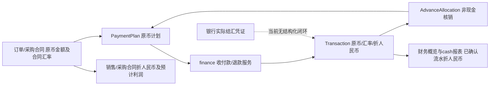

# R1-FIN-AUDIT-01 财务统计与结汇兼容性审查

日期：2026-10-18；审查基线：`f779ed858da3bc4dd468645f5405b0fed2556a8d`，最新origin/master。隔离工作区 `.worktrees/r1-fin-audit-01`。本轮为源码只读审查与拟议方案，未连接业务数据库、读取银行明细、执行业务API或修改核心代码。下文所有金额均为合成示例。方案须独立复审及另行实施授权；FUP-02未实施。

## 1. 结论

现有系统已具备原币业务台账、分期核销、预收预付分配及人民币折算统计，不应重建这些功能。缺失的是可追溯的银行结汇事实及其与原币收付款的关系。`rmb_amount`虽然名为“实际人民币金额”，但主创建路径强制按原币×汇率产生，不能证明人民币实际到账。

建议保留全部历史字段与原币核销，增量增加“银行资金事实 / 结汇批次 + 来源分配关系”，另设经确认人民币资金统计；旧折算统计保留并改清口径。结汇属于币种转换，人民币到账不等于再次获得销售收入；不能同时把原外币折算和结汇到账累计为实际人民币收入。

本轮只确认代码行为及口径缺口，不判定真实账务损失、不推断历史是否已结汇。没有业务库分布或银行凭证，历史受影响数量、金额和确认日期均为UNKNOWN。

## 2. 现有完整数据流与指标血缘

源码链接使用基线文件和函数名定位，行号均针对本轮基线。

| 模块 / 指标 | 来源及计算 | 性质、日期、边界 |
|---|---|---|
| Transaction.amount/currency/exchange_rate/rmb_amount | models.py:1455起；amount/allocated_amount/rmb_amount均4位，汇率6位；finance.py:81 record_transaction丢弃外部rmb_amount，按applied_amount×exchange_rate量化4位；超额及退款同类计算 | 原币收付款是人工登记业务事实；人民币值为系统折算，参考号/备注非银行验证。收款汇率可人工填，不能一概称合同汇率，也不能称银行实际到账 |
| PaymentPlan | planned_amount/settled_amount各4位，remaining=planned-settled；计划按合同币种；默认分期最后一笔承接剩余值 | 债权债务辅助账；不等于银行现金。remaining_rmb按合同汇率换算，逾期按open及到期日期，见serializers.PaymentPlanSerializer与views.PaymentPlanViewSet |
| AdvanceAllocation | advance→plan，原币金额、is_active；allocate_advance锁定原流水/计划，校验币种、客户/供应商及余额，不创建现金流水 | 仅核销关系。再次把allocation计入现金会重复；已支持撤销历史 |
| Order.total_amount / paid_amount / outstanding_amount | 合同行+运费-折扣+已批准变更；paid=有效客户收款+有效预收分配-退款；outstanding=sum有效open应收计划余额；草稿/取消例外 | 合同额与原币已收/应收分离。银行结汇不应改变客户已付款事实，也不重新核销计划 |
| PurchaseOrder | 原币采购行、变更及供应商付款/退款/预付分配；采购合同汇率独立于付款汇率 | 合同应付及成本基础，非银行人民币付款证明；逐笔实际付款可多汇率 |
| finance_dashboard income_rmb/expense_rmb/net_cash_rmb | views.py:1952起，confirmed Transaction按transaction_date区间；逐行rmb_amount or amount×exchange_rate，再按direction求收入/支出/差额 | 当前混合CNY及外币折算；无结汇状态筛选。categories、monthly_cash同一来源；“实际收入/实际支出”不能解释为已核实人民币银行流入/流出 |
| receivable_rmb/payable_rmb | 所有有效open计划剩余原币×所属合同汇率 | 当前时点估值，不按流水实际结汇汇率；不受现金期间筛选直接限制。due_items为到期含今日、最多12条，不是全量逾期账龄表 |
| advance_receipt_rmb/advance_payment_rmb | confirmed未分配预收/预付(amount-allocated_amount)×原流水汇率 | 当前余额折算，不是期间新增银行现金；不可与income_rmb直接相加 |
| sales_rmb/monthly_sales_rmb | 有效订单按order_date区间，total_amount×订单汇率；两键用同一期间sales_rmb | 经营合同额；monthly键不是独立银行月度收入，含未收款订单 |
| purchase_cost_rmb/order_expense_rmb/estimated_profit_rmb | profit.py:8；销售合同折算-采购归属成本-有效订单费用。purchase_costs.order_purchase_cost以归属金额×采购汇率；附加费用分摊复用split_amount | 预计订单利润，非会计净利润，也非人民币可用余额。采购成本分摊不创建付款或库存流水；改结汇统计不得顺便改成本政策 |
| reporting sales/purchase/profit | reporting.py:69 records：有效合同商品行及独立金额调整按合同汇率；profit复用order_profit_summary | 商品行外的调整不摊SKU；不能把合同额当已收。日期维度按用户选择，不同指标不天然同期间 |
| reporting cash | confirmed流水，收入正、支出负，rmb_amount优先否则折算；不读取AdvanceAllocation作新增现金 | 保持净收支口径，当前仍无法区分已结汇。cash totals.count为去重单据/流水数量，不是银行笔数 |
| 报表CSV | views.finance_dashboard exporting沿用monthly_cash/categories，标题“实际收入（人民币）”；reporting.report_data沿用aggregate，Decimal直接字符串输出，含口径note、筛选及比较期间，safe_csv处理文本 | 与页面同源的口径错误会进入CSV；CSV未统一币种最小单位格式。不得只修改页面、遗留导出旧称 |

页面链路：FinanceDashboardPage读取/finance并显示“实际收入/实际支出”；TransactionPage展示人民币流水小计，输入称“结汇汇率”，但没有结汇凭证、批次、未结汇余额；PaymentPlanPage登记原币核销，金额/汇率送服务端，remaining_rmb提示按合同汇率折合；ReportsPage通过catalog/data及ReportBlock渲染、导出，显示服务端note。前端Number、formatMoney两位格式仅显示，不是服务端记账政策。

## 3. 已有能力与缺失能力

| 能力 | 可直接复用 | 缺口及兼容要求 |
|---|---|---|
| 收款、供应商付款、分期/多汇率 | record_transaction / record_contract_payment，逐计划拆分，合同币种一致及事务校验 | 付款汇率不等于实际人民币银行支出；新增事实关联不能再次登记同笔收款 |
| 超额收付款 | 原计划部分+ADV未分配预收/预付，split_from保留家族关系 | 一个银行事件可能对应多个Transaction；关联须覆盖拆分家族，不能只读根行金额 |
| 预收预付与分配 | allocate_advance及AdvanceAllocation，原币余额/身份/币种校验 | 核销不产生现金；结汇可发生在核销前后，结汇可用余额不能用未分配应收余额代替 |
| 退款 | record_contract_refund按后到期计划回退已核销额，生成反向现金流水 | 原币退款不等于CNY退款；已经结汇资金的购汇或人民币退款需独立银行事实及反向关联 |
| 汇兑差额 | Transaction.kind=exchange_difference；serializer允许收入/支出；前端目前仅列“汇兑损失” | 仅人工分类，无结汇匹配、成本基础或自动计算闭环。差额通常非额外银行现金，不能把分类流水和实际到账重复计现金；收益入口/方向需单独验收 |
| 作废 | void_transaction锁根/拆分树、恢复计划及allocation，状态取消/原因/历史保留 | 新银行关系存在时不得只作废原流水而留下有效结汇统计；须拒绝或原子冲销依赖，禁止覆盖历史 |
| CSV及权限 | 两条报表导出、数据范围、finance_scope、来源模块权限及开发superadmin入口 | 新统计必须复用权限/范围及导出校验，不借“实际资金”新接口泄露全量银行资料 |
| 银行账户/结汇 | 没有完整对应模型或专用服务；reference/payment_method仅文本 | 多对多结汇、银行实际金额/日期、凭证状态、未结汇余额与费用关联缺失 |

## 4. 明确缺陷与待验证风险

1. **确认的语义/来源缺陷（ISS-105，P1 OPEN）**：Transaction.rmb_amount字段标题、财务概览“实际收入”及CSV“实际人民币”与强制乘汇率生成的来源不一致。未结汇外币也会进入此汇总。源码可确认；不据此推断银行实际金额一定不同或已重复入账。
2. **确认的零值判定隐患**：views、reporting、profit及TransactionSerializer用`rmb_amount or ...`把0当缺失，模型默认0也不能区分未知与已确认零。新增净到账为0等事实不能复用此判定；现有真实影响未做数据库核实，归入ISS-105后续分支。
3. **拟议精度政策尚未实施**：现有4位字段与历史测试是既有规则，不能直接称历史坏账。finance.quantize未明确rounding，多处默认上下文策略与导出ROUND_HALF_UP不同；统一正式入账政策需另行变更及验收。
4. **拆分尾差风险**：原币拆分各自×汇率独立舍入，没有现金事件人民币总额作为守恒基准。合成Decimal例：两份0.01、汇率1.005000，各量化4位0.0100，相加0.0200；整体0.02×1.005000量化4位0.0201。此为公式示例，不是已发现真实银行差额。新两位政策下更需事件总额及尾差分配测试。

## 5. 最小兼容方案（拟议，未实施）

保留Transaction.amount/currency/exchange_rate/rmb_amount、PaymentPlan、AdvanceAllocation、split_from及历史状态。旧rmb_amount对外称“人民币折算金额（历史参考）”，exchange_rate称“折算汇率”，不得批量改值或静默改字段存储语义。新实际值使用明确独立来源，避免同字段新旧两种含义。旧API字段名先保留，新增口径版本/来源说明；客户端按版本选择，不靠金额非零猜来源。

建议增量模型（名称暂定，设计待审）：

- BankCashEvent：资金事实ID、稳定业务键、发生日期、币种、方向、实际金额、来源类型（直接收付/结汇/手续费/内部转账）、已确认/冲销状态、外部参考、对账来源和操作追溯。结汇事件记录外币交付、CNY毛额、费用币种/金额及CNY净额；明确费用含扣/另扣，不能只存一个含义不明净值。
- FXSettlementAllocation：结汇事件→原始收款Transaction/现金家族，分配原币和CNY金额，明确root/拆分覆盖及可冲销关系。支持多对多；分配额度来自现金家族剩余可结汇原币，独立于AdvanceAllocation未核销余额。退款、已作废、已结汇及冻结额度均要计入可用性。
- 对直接CNY收付款，事实关联同一Transaction，单一业务事件只认一次。费用若关联既有费用Transaction，则不能再生成第二笔费用；无法匹配时必须提示人工核对，不能以金额相等自动去重。

**银行账户模型**：MVP非强制完整余额总账。最少保留来源/目标账户标识及币种，不保存敏感完整卡号；可先用受控账户引用。只有要求逐账户余额、转账对账、付款资金来源或多银行混合费用时，再引入轻量BankAccount档案及期初对账；不得没有期初与完整变动就显示“真实账户余额”。全外币总账、自动银行导入、实时汇率、会计凭证引擎可暂缓。

**统计源与防重复**：新增“已确认人民币资金流入/流出/净流量”，按银行事件日期、CNY方向和事实确认状态统计。原币收款仅进入辅助台账和折算参考；结汇入CNY资金视图，不能再登记第二笔客户收款或作为第二次销售收入。跨币种结汇在账户视图产生外币减少/CNY增加，在全币种外部收支口径属于内部转换；两类图表分开，不能把结汇当额外对外收入。原已登记CNY流水通过1:1事实映射计一次，不能再将旧cash查询整表相加。

| 场景 | 最小操作与统计 | 核销/保护 |
|---|---|---|
| A 收到外币未结汇 | 复用客户收款；显示外币已收与未结汇；实际CNY资金不增加，参考折算单列 | 按原币核销应收，即使尚未结汇也可结清客户债务 |
| B 收到即结汇 | 一次协调动作关联原收款与结汇事实，记录银行实际日期/净到账；原收款仍只有一次 | 稳定请求键、事务或明确可重试草稿/确认状态；不得先成功收款后失败结汇又重复收款 |
| C 一笔分次结汇 | 同来源多条allocation，累计交付不超可结汇原币；每次独立日期/实际CNY | 锁来源额度、并发及冲销后额度恢复；原应收不重复核销 |
| D 多笔合并结汇 | 一事件关联多来源，按同一币种/可用账户池分配；不同客户债权不互相核销 | CNY实际总额守恒；来源分摊仅分析归属，不产生第二现金事件；混币需拆外币腿，MVP可明确拒绝 |
| E 银行手续费 | 毛额-扣费=净额（同CNY）；同批含扣与另笔扣分开建关联；外币手续费保留实际外币事实 | 可选毛流入+费用流出或净流入展示，但同口径不得净额后再扣一次费用；费用归订单/期间沿用现有分类，待业务确认 |
| F CNY直接收付款 | currency=CNY、rate=1，原币金额即CNY事实金额；登记时明确是人工确认的实际付款，非已银行自动对账 | 不强制新增结汇；关联一个资金事实，现有计划/预付款照常 |
| G 历史来源未知 | 原值冻结为legacy_unverified/reference；实际资金视图单列未核实数及参考总额，不伪造已确认0 | 不凭币种、汇率、备注猜已结汇；凭银行证据追加确认/修正关系，无证据就保留UNKNOWN |

供应商外币付款同理：辅助账已付与CNY购汇/银行付款分开。现存exchange_difference不能默认作为真实现金事件；是否进入经营分析、会计损益及其计算基础需业务确认。本方案不重定预计利润或收入确认政策。

## 6. 金额精度与舍入

拟议新正式资金金额：CNY/USD等2位，JPY拟按最小单位0位；币种精度由经核验配置统一驱动，不对全部币种硬编码2位。汇率保留6位；数量、交易单位换算、单价12位、库存成本等维持业务精度。银行实际金额是输入事实，不能用6位汇率重算覆盖；实际隐含汇率可派生供展示，不反写事实。

统一使用Decimal字符串输入，显式ROUND_HALF_UP进行允许的计算入账；直接输入超过币种最小单位原则上拒绝并提示，若产品要求自动舍入则须预览与明确确认，避免静默改银行凭证金额。新服务层和serializer均须约束，不能只限制HTML step。前端Number仅做显示，金额校验/合计守恒由服务端完成。

已有实现应先收敛再复用：quotation_export_dto.py:46、quote_export.py:47、quote_xlsx_renderer.py:63均有两位ROUND_HALF_UP；purchase_costs.py:72 split_amount先ROUND_HALF_UP，再ROUND_DOWN和稳定最大余数分摊，能保证份额总和。它们分别服务报价展示与正向采购成本，不能直接当所有币种、负退款、空权重的通用入账工具。建议抽出一个按币种量化/校验入口和可配置最小单位分摊接口，原调用分阶段委托；别再添加第二套固定CENT工具。finance默认分期、退款、超额、合同变更及serializers balance需逐项核对舍入边界；成本政策本轮不改。

历史风险清单：Transaction.amount/rmb_amount/allocated_amount、PaymentPlan.planned/settled、AdvanceAllocation.amount、合同变更/运费折扣4位；若直接改decimal_places=2，会改变计划等式、拆分总额、预付款可分配额、退款上限和历史报表，并可能产生零碎余额。两笔历史合成验证87.9034及16.6689本来符合旧4位规则，不能通过SQL改为87.90/16.67“修复”。同理不批量改报价/成本/单价字段。

拆分规则建议：先确定银行事件最终实际总额，再按原币权重及稳定顺序分摊最小单位，最后残差分配；保存分摊依据和版本。默认原币分期以合同正式原币总额为准，最后一期承接尾差。退款/冲销尽量精确反向复用原分配快照，不按新汇率重算旧份额。验收含1.005→1.01、负半值、JPY、0/超限、三等分0.01、不同汇率、超额拆分和部分反向操作。

## 7. 模型、API、页面及历史保护

| 层 | 拟议触及 | 边界 |
|---|---|---|
| 模型/迁移 | 增量事实与allocation；可选轻量账户引用；精度策略版本 | 不降历史字段精度、不update历史余额、不删根流水/拆分/核销关系 |
| 服务 | 新结汇/实际资金确认服务，复用事务、唯一业务键、行锁；原finance收付/退款/作废增依赖校验 | 客户核销不因结汇新增一次；发生未知响应沿用FUP-01风险保护和稳定键，唯一冲突不直接认定成功 |
| API/权限 | 新资金事件/结汇确认、预览、列表及冲销；dashboard/report增加明确basis/version | 来源Transaction/订单数据范围、财务读写/导出、开发superadmin统一入口均复用；无正式RBAC切换 |
| 页面 | TransactionPage保留原币记录，增加结汇关联/待结汇；独立简洁结汇表单；FinanceDashboard明确实际资金/参考折算；PaymentPlan维持原币核销；ReportsPage/ReportBlock及CSV同步口径 | 不能把应收“已结清”和资金“已结汇”混为一项；旧筛选和导航保留，缺权限不泄露实际金额 |
| 历史/审计 | 只追加来源确认、调整、冲销、关联版本、历史报表basis及cutover时间 | 原历史快照可重算旧口径；新口径缺数据明确提示不完整，不能静默产生看似完整的零现金历史 |

如需迁移，先以获授权只读脚本分类统计“有效币种/4位非零尾数/拆分家族/原币核销一致性/缺失日期/已作废/未知来源”，仅输出脱敏计数与校验和；本轮未读取这些真实数据。迁移脚本必须dry-run、备份、逐条来源和可逆映射；人工补证与期初确认分开，不因历史CNY字段非零自动认证。回滚停用新统计版本，不能删除已确认银行事件掩盖操作。

## 8. 分阶段实施、复杂度与验收

工作量为源码分析后的粗估“工程人日”，非排期承诺，含针对性回归、不含等待银行资料或独立复审；不得据此自动开工。

| 阶段 | 范围 / 粗估 | 通过标准 |
|---|---|---|
| P0 口径决策与数据盘点 | 2–3日，低到中 | 财务负责人确认实际资金≠销售收入、净额/毛额手续费、CNY人工确认、历史cutover及汇兑损益处理；脱敏只读盘点，旧报表快照留存 |
| P1 最小事实与结汇闭环 | 5–8日，中到高 | A/B/F/G；银行事实可独立于原币核销；无证据不进确认统计；幂等/事务/失败无部分确认，已有收款不重复生成，权限与导出通过 |
| P2 多对多及反向链路 | 4–7日，高 | C/D/E；并发不可超额结汇；gross-fee=net及分摊守恒；部分退款/冲销/原流水作废关联一致，历史快照不改；预收分配前后结汇均正确 |
| P3 统计切换与精度入口 | 4–6日，中到高 | dashboard、cash报表、CSV同源同basis、日期正确、跨币转账不重复收入；币种最小单位/ROUND_HALF_UP/尾差/新旧并行；保留原精度历史只读展示 |

合计粗估15–24工程人日，受是否引入账户对账、历史数据质量和集成复杂度影响；P3精度基础能力须在P1设计时确定，不能等P1已入账后再改规则。完整测试须SQLite、PostgreSQL（锁/并发/事务）、Node、Vitest、Playwright、Build；隔离数据库真实UI覆盖A–G、失败重试、权限、重新加载、反向动作，附原始HTTP/前后Decimal核对、原图及精确HEAD三项CI。模拟API、fixture、真实UI、真实API、DB核对分别标记。

## 9. 本轮验证与交付边界

已核对上述模型、服务、serializer、views、reporting及四类页面；只读grep/源码分析和合成Decimal公式不代表业务UI已验收。本轮没有运行全量应用测试或浏览器业务写入：没有核心代码变更，不将上一轮CI冒充本轮业务验证。提交后CI状态仅证明文档提交未破坏现有基线，不证明本方案已实施。

仅新增本报告、更新文档台账/阶段记录（ISS-105 OPEN，既有Issue不改状态）。最终提交SHA以Git及交付消息为准。完成后停止等待ChatGPT独立复审；不进入FUP-02、R1-B、正式RBAC、员工UAT或部署。

## 附：源码复核入口

- [模型：Order/PurchaseOrder/PaymentPlan/Transaction/AdvanceAllocation](../backend/crm/models.py)；[序列化与字段保护](../backend/crm/serializers.py)。
- [收付、超额、退款、预收分配与作废](../backend/crm/services/finance.py)；[预计利润](../backend/crm/services/profit.py)；[采购成本归属及尾差分摊](../backend/crm/services/purchase_costs.py)。
- [财务概览及CSV](../backend/crm/views.py)；[通用报表及CSV](../backend/crm/reporting.py)。
- [财务概览页面](../frontend/src/views/FinanceDashboardPage.vue)；[新增记账](../frontend/src/views/TransactionPage.vue)；[应收应付](../frontend/src/views/PaymentPlanPage.vue)；[报表页面](../frontend/src/views/ReportsPage.vue)。
- [金额显示工具](../frontend/src/utils/money.js)；[报价DTO舍入](../backend/crm/quotation_export_dto.py)；[报价导出](../backend/crm/quote_export.py)；[XLSX舍入](../backend/crm/quote_xlsx_renderer.py)。
