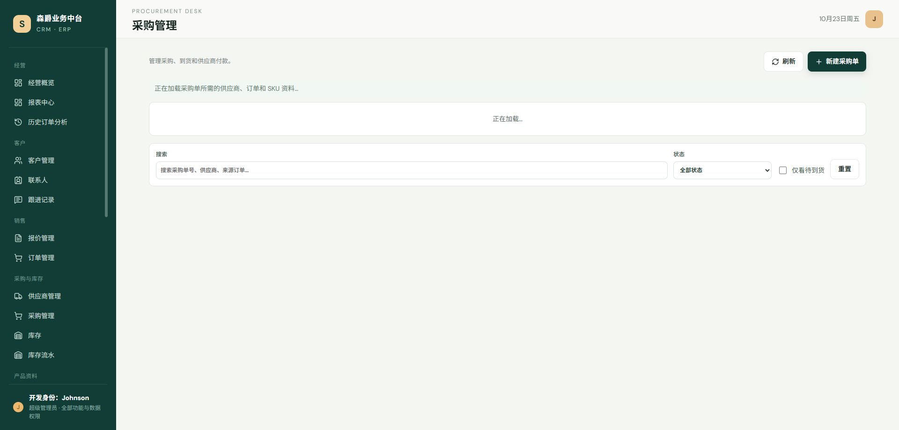
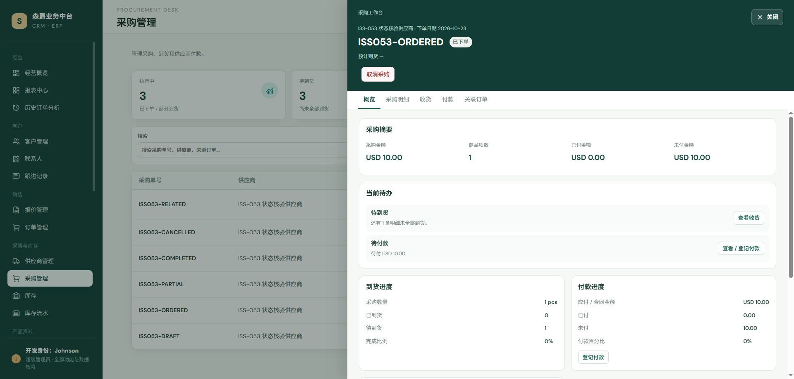
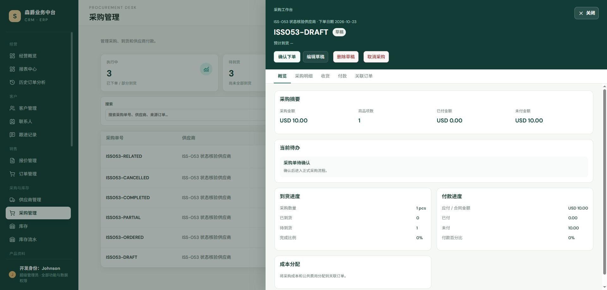
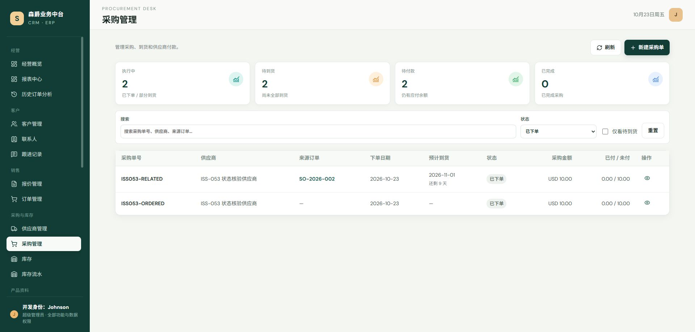
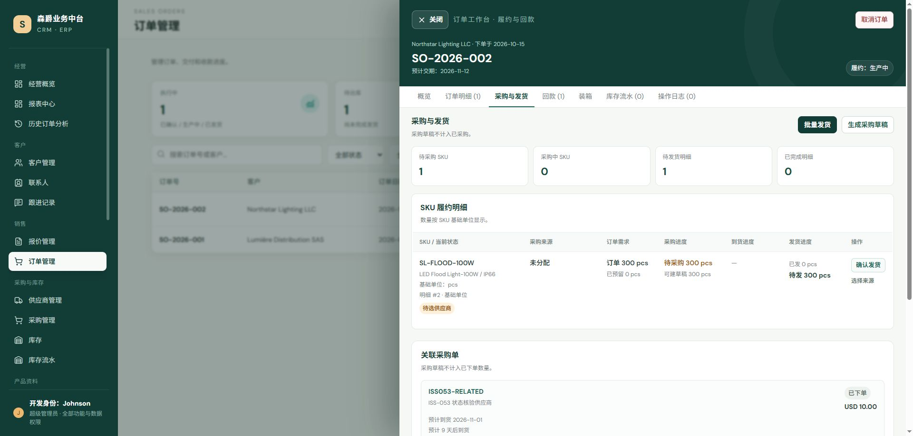

# ISS-053 采购单状态中文显示核实

## 结论

本轮在统一基线 `c356e57014d28295485d52df23612c2fe6c02444` 的独立 worktree `codex/iss-053-purchase-status` 中完成核实。当前没有确认仍存在的采购状态中文显示缺陷，因此没有修改前后端业务代码，也没有修改采购生命周期、状态转换或数据库枚举。

| 分类 | 结论 |
| --- | --- |
| 已确认缺陷 | 无。`ordered` 在 API 中保持英文枚举值，同时所有已实测用户可见入口显示“已下单”。 |
| 本轮已修复缺陷 | 无。本轮仅补充 API、自动化和真实 Chrome 证据。 |
| 历史误报 / 当前未复现 | 历史记录中的英文 `ordered` 在当前基线未复现；由于无法重建历史现场，记录为“当前未复现的历史报告”，保留独立复审，不据此自行关闭 ISS-053。 |

## 环境与数据边界

- 后端：`http://127.0.0.1:8313`；前端：`http://127.0.0.1:5314`。
- 数据库为本独立 worktree 的 SQLite，仅建立 `ISS053-DRAFT`、`ISS053-ORDERED`、`ISS053-PARTIAL`、`ISS053-COMPLETED`、`ISS053-CANCELLED` 及带来源订单的 `ISS053-RELATED` 样本；不写入主 worktree 或生产数据。
- 当前操作身份为开发超级管理员；`development_superadmin: true`、`rbac_enforcement: false`，符合项目开发阶段权限约定。

## 代码核对

- `backend/crm/models.py:1025` 的 `PurchaseOrder.STATUS_CHOICES` 保留英文存储值 `draft / ordered / partial / completed / cancelled / historical`，对应中文显示值“草稿 / 已下单 / 部分到货 / 已完成 / 已取消 / 历史订单 · 仅用于经营分析”。
- `backend/crm/serializers.py:542-578` 的 `PurchaseOrderSerializer` 以 `get_status_display` 只读暴露 `status_display`，同时保留 `status` 原始枚举。
- `backend/crm/views.py:240` 使用精确的 `status` 查询参数筛选，不把中文文案写回状态值；`PurchaseOrderViewSet` 的状态更新限制和生命周期动作保持原样。
- `frontend/src/views/PurchaseOrderPage.vue:182` 只提交英文筛选值，`frontend/src/views/PurchaseOrderPage.vue:411` 使用中文筛选选项，`frontend/src/views/PurchaseOrderPage.vue:462` 列表显示 `row.status_display`。
- `frontend/src/components/PurchaseDetailModal.vue:36` 详情标题显示 `row.status_display`；草稿编辑器不提供状态输入，保存时不提交状态字段，避免绕过生命周期。
- `frontend/src/components/OrderDetailModal.vue:426` 的销售订单“关联采购单”卡显示 `purchase.status_display`；`backend/crm/views.py:1849` 的履约接口使用同一序列化器；`backend/crm/context.py:381` 的采购实体上下文 badge 使用 `get_status_display()`。

## API 证据

请求：`GET /api/purchase-orders/?page_size=100`

```json
[
  {"purchase_no":"ISS053-CANCELLED","status":"cancelled","status_display":"已取消"},
  {"purchase_no":"ISS053-COMPLETED","status":"completed","status_display":"已完成"},
  {"purchase_no":"ISS053-DRAFT","status":"draft","status_display":"草稿"},
  {"purchase_no":"ISS053-ORDERED","status":"ordered","status_display":"已下单"},
  {"purchase_no":"ISS053-PARTIAL","status":"partial","status_display":"部分到货"},
  {"purchase_no":"ISS053-RELATED","status":"ordered","status_display":"已下单"}
]
```

状态筛选请求 `GET /api/purchase-orders/?status=<enum>` 的结果均为单一匹配状态，并保持如下映射：

| 查询值 | 返回状态值 | 返回显示值 |
| --- | --- | --- |
| `draft` | `draft` | 草稿 |
| `ordered` | `ordered` | 已下单 |
| `partial` | `partial` | 部分到货 |
| `completed` | `completed` | 已完成 |
| `cancelled` | `cancelled` | 已取消 |

其他引用路径：

- `GET /api/purchase-orders/2/`：`{"purchase_no":"ISS053-ORDERED","status":"ordered","status_display":"已下单"}`。
- `GET /api/context/purchase-orders/2/`：`{"entity":"purchase-orders","title":"ISS053-ORDERED","badge":"已下单"}`。
- `GET /api/orders/2/fulfillment/`：关联采购单 `ISS053-RELATED` 返回 `status:"ordered"`、`status_display:"已下单"`。

## 真实 Chrome 证据

使用真实 Chrome 访问 `http://127.0.0.1:5314`，没有提交保存、下单、收货、付款或取消动作。

- 采购列表：六条样本状态均显示中文，包含 `ISS053-ORDERED · 已下单`。

  

- 已下单详情：工作台标题显示 `ISS053-ORDERED 已下单`，操作按钮与待办文案均为中文。

  

- 草稿编辑：工作台仍显示 `ISS053-DRAFT 草稿`；编辑表单没有状态字段，未引入英文状态或状态改写入口。

  

- 状态筛选：选择“已下单”后 URL 为 `?status=ordered`，列表只保留两条 `ordered` 样本，均显示“已下单”。

  

- 销售订单“采购与发货”页的“关联采购单”卡显示 `ISS053-RELATED · 已下单`。

  

## 测试日志

| 命令 | 结果 |
| --- | --- |
| `backend: manage.py test crm.tests.test_contract_lifecycle crm.tests.test_finance_data_scope crm.tests.test_document_numbers --verbosity 1` | **39 tests OK**；覆盖采购草稿保存、下单、收货、取消、成本归属、付款上下文和状态生命周期。 |
| `frontend: npx vitest run tests/purchase-order-filters.spec.js tests/purchase-order-navigation.spec.js tests/purchase-editor-receipt.spec.js tests/order-fulfillment-ux.spec.js --environment jsdom` | **4 files / 52 tests passed**。 |
| `frontend: PLAYWRIGHT_CHANNEL=chrome npx playwright test browser-tests/final-cross-module-ux.spec.js --workers=1` | **6 passed**。 |
| `frontend: PLAYWRIGHT_CHANNEL=chrome npx playwright test browser-tests/fulfillment-receivables.spec.js --workers=1` | **5 passed**；Vite 有既存 `Transition` 非元素根节点 warning，但无测试失败。 |
| `frontend: npm run build` | **成功**；Vite 完成 2009 modules 构建，仅有既存 chunk size warning。 |

仓库默认的 `npm run test:unit` 直接调用 `node --test`，对 Vue 单文件测试会报 `.vue` 扩展名无法加载；因此 Vue 测试按仓库已安装的 Vitest 执行，未将该脚本入口问题混入业务测试结论。并发 Playwright 首轮曾因 5195 端口开发服务器连接中断出现环境性失败，单 worker 重跑后全部通过。

## 边界与后续

- `status` 的数据库/API 值仍为英文枚举；中文仅来自 `status_display` / `get_status_display()`，筛选仍提交 `ordered` 等英文值。
- 本轮未修改 `backend/` 或 `frontend/` 业务代码，未触及 ISS-049、ISS-067 文件。
- ISS-053 仍等待统一独立代码、权限、API 和视觉审查；本证据不代表合并 master、关闭 Issue 或替代独立验收。
