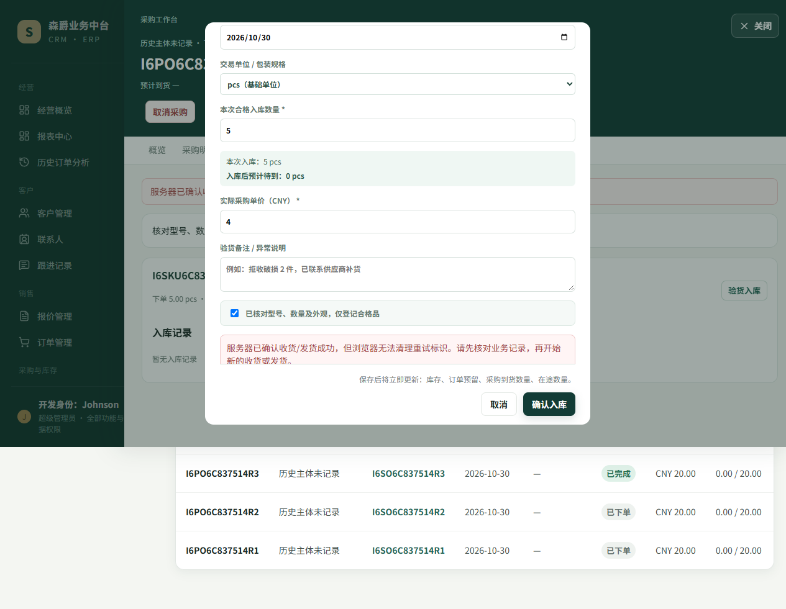
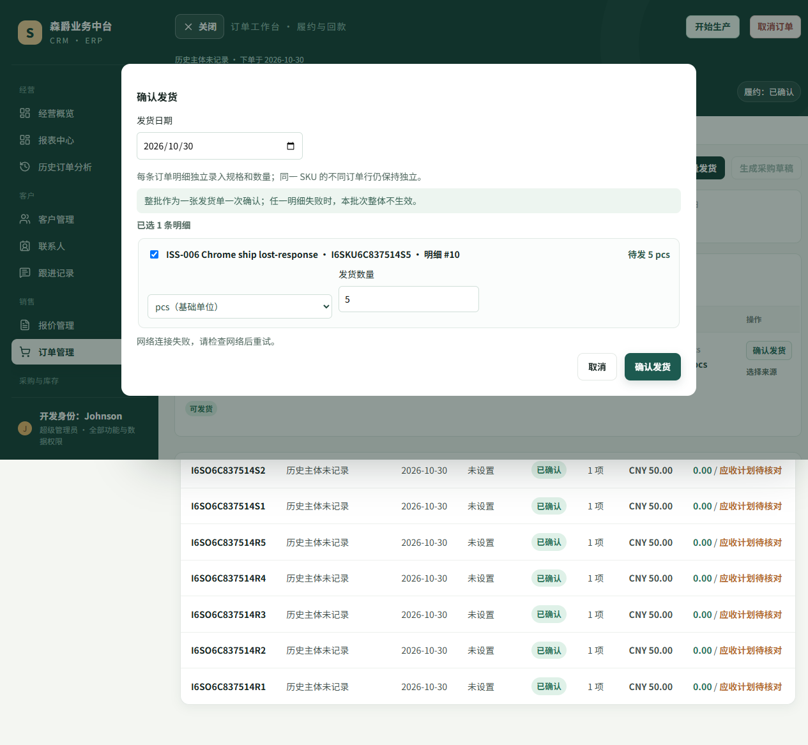

# R1-ISS006-FRONTEND-STORAGE-CHROME-VERIFY

日期：2026-10-30
基线：`f83f9b08a5f516f860655bc08b6c7d5f0787c35e`
分支：`codex/r1-iss006-frontend-storage-chrome-verify`

## 结论

PASS：在真实桌面版 Chrome 中，采购收货与订单发货的会话存储异常均会阻止不安全提交；存储恢复后会沿用原请求 ID。服务器已成功但 `removeItem` 失败时，页面明确提示先核对业务记录；网络响应丢失后的重试也使用相同 ID。隔离 SQLite 的直接查询确认，失败存储场景没有业务记录，成功或重试场景每种操作只创建一条业务记录和对应库存流水。

本轮没有发现需要修改的产品业务缺陷。没有连接业务数据库、修改真实数据或媒体文件，也没有触发 GitHub Actions、部署或合并。

## 浏览器及隔离环境

- 浏览器：Google Chrome `156.0.8078.48`，Playwright `channel=chrome`，`headless=false`；Chrome UA 与版本记录在 [`browser-environment.json`](browser/iss006-frontend-storage-chrome.spec/browser-environment.json)。
- 环境：Windows；Python `3.14`、Django `6.0.6`、Vite `8.3.5`。默认桌面视口，截图为全页截图。
- 每轮使用隔离运行器创建全新 SQLite 数据库、媒体目录、API/Vite 端口与 10 组仅供测试的合成采购/销售订单。隔离身份、数据库与媒体路径校验通过。
- 最终记录的运行 ID：`6c837514-e591-47e1-8202-ca93afb41a31`。10/10 测试通过，Playwright 与隔离运行器退出码均为 `0`。运行器确认只清理本轮拥有的服务进程，释放两个端口，并删除本轮临时数据库及媒体目录。

## 场景与结果

| 页面 / 操作 | Chrome 中验证的行为 | POST / 最终数据库结果 |
|---|---|---|
| 采购收货、订单发货 | `window.sessionStorage` 属性读取抛错 | 中文阻止提交提示；0 次 POST；0 条收货/发货记录 |
| 采购收货、订单发货 | `sessionStorage.getItem` 抛错 | 中文阻止提交提示；0 次 POST；0 条收货/发货记录 |
| 采购收货、订单发货 | 首次 `setItem` 抛错，随后恢复存储 | 首次 0 次 POST；恢复后请求 ID 与首次生成的 UUID 相同；1 条业务记录及 1 条自动库存流水 |
| 采购收货、订单发货 | 服务器成功后 `removeItem` 抛错，再恢复存储重试 | 明确提示服务器已确认成功、先核对记录；两次 POST 使用同一 ID；各只有 1 条业务记录及 1 条自动库存流水 |
| 采购收货、订单发货 | API 已返回 201 后，浏览器收到的响应被丢弃，再重试 | 首次页面显示中文网络重试提示且按钮恢复可用；两次 POST 使用同一 ID；各只有 1 条业务记录及 1 条自动库存流水 |

SQLite 查询明细见 [`database-verification.json`](browser/iss006-frontend-storage-chrome.spec/database-verification.json)。逐项请求方法、URL、请求体、幂等键、响应/失败以及页面错误记录见 [`browser-results.json`](browser/iss006-frontend-storage-chrome.spec/browser-results.json)。其中响应丢失场景通过拦截真实本地 API 响应实现：拦截器先从后端取得 `201`，然后才中止浏览器响应；没有用假 API 代替业务处理。

## 截图

采购收货和订单发货的 16 张逐场景截图均保存在 [`screenshots/`](browser/iss006-frontend-storage-chrome.spec/screenshots/)；原始隔离运行日志见 [`isolated-chrome-run.log`](isolated-chrome-run.log)。

## 测试与实现范围

- 新增 `frontend/browser-tests/iss006-frontend-storage-chrome.spec.js`，在系统 Chrome 中执行 10 个收货/发货用例。
- 扩展隔离运行器，只为该定向测试登记合成数据 seed 和结束后的 SQLite 验证脚本；其他业务测试的隔离配置不变。
- 隔离 Playwright 配置支持通过环境变量显式选择 headed 模式，以便此次 Chrome 验收真实显示浏览器窗口。
- 未修改订单、采购或幂等键产品实现。

补充回归：幂等存储 Vitest 定向测试 7/7 通过；隔离运行器验证测试 14/14 通过；JS/Python 语法检查及 `git diff --check` 通过。

## 非阻断日志

测试期间 Vite 记录了订单详情弹窗 `<Transition>` 的 Vue 警告，Django 记录了当前列表分页排序警告；订单页面还请求了可选的装箱方案接口并收到 404，前端按现有逻辑忽略该可选结果。它们未产生浏览器 `pageerror`，不影响本次收货/发货断言。本轮不扩展处理这些不相关事项。
