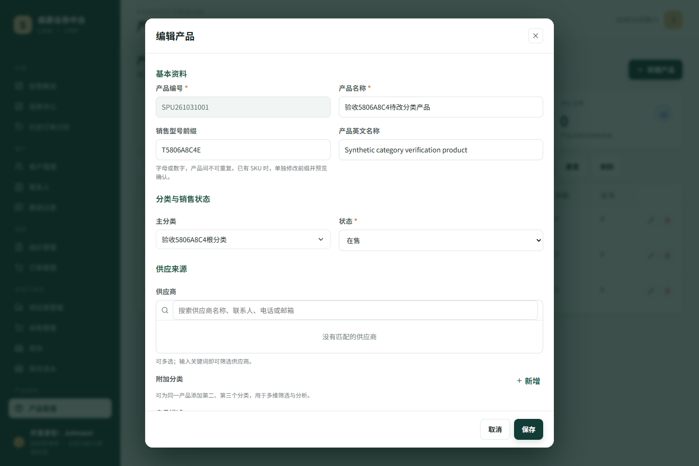
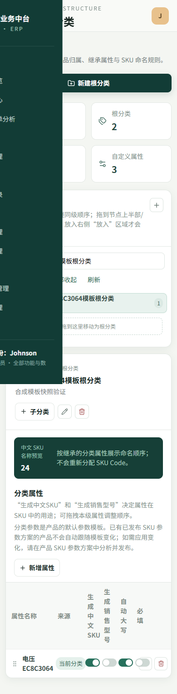

# R1-ISS-028-035 产品分类及 SKU 模板专项复验

日期：2026-10-31
基线：`bd324a8c3fb64af245c3afcabbd4301c84f7711c`
历史成果：`901b762fba20ed558f554cfba37175b303f83db9`
分支：`codex/r1-iss028-035-category-verify-20261031`

## 结论

PASS：最新基线已包含历史根分类直接选择修复。本轮真实 Chrome 在隔离数据库和合成数据中复验根分类直接归属、根/子分类筛选、属性继承、模板变更后新旧 SKU 行为边界、普通 SKU 编辑保存/重开，以及报价和订单历史快照。未发现产品缺陷；没有修改产品业务代码、真实历史 SKU 或数据库迁移。

仅加强一条浏览器回归断言：在已有数据库前后检查中显式比较 `identity_signature`，以覆盖“SKU 身份不得变化”的验收要求。窄屏全局侧栏遮挡继续保留为独立 UX 遗留项，本轮没有扩展处理。

## 基线与历史修复对照

- 历史提交 `901b762` 的 `frontend/src/views/ProductPage.vue` 与最新基线 blob 相同（`cf60c2affe6b7e8cd5779a981de182da6da24a8c`）；根分类有子项时仍提供独立“选择”操作。
- 历史 Playwright 专项测试也已存在于基线。本轮仅在其既有数据库快照比较中加入 `identity_signature` 断言；没有重复移植产品修复。
- 不新增迁移，不修改共享项目台账，不连接或修改真实业务数据。

## 环境与运行

- 浏览器：Google Chrome `156.0.8078.48`，系统 Chrome channel；Playwright `@playwright/test 1.64.0`。截图由本轮 Chrome 页面生成。环境记录见 [`browser-environment.json`](browser-environment.json)。
- 隔离运行 ID：`495306ca-275f-493d-875c-c69c443dcb66`。运行器创建临时 SQLite 和 MEDIA_ROOT，API/Vite 端口为 `6836/6837`；运行结束端口已释放，运行器拥有的临时数据库和媒体目录已删除。
- 原始隔离 Chrome 日志：[`isolated-chrome-run.log`](isolated-chrome-run.log)。请求记录及完整数据库前后快照：[`iss028-http-results.json`](browser/iss028-035-category-schema.spec/iss028-http-results.json)、[`iss035-api-and-db-snapshots.json`](browser/iss028-035-category-schema.spec/iss035-api-and-db-snapshots.json)。

## 验收结果

| 检查项 | 结果 |
|---|---|
| 根分类直接选择并保存为产品主分类 | PASS；产品详情 API 返回根分类 ID/名称 |
| 根分类筛选、子分类筛选 | PASS；根类结果含两个预期产品，子类仅含对应子类产品 |
| 根类属性对子分类继承 | PASS；API 标为 inherited，分类页显示来源且继承规则不可编辑 |
| 修改分类模板并刷新 | PASS；规则从 `uppercase=false` 变为 `true` 并在重载后保持 |
| 已发布 SKU 参数方案与身份 | PASS；SKU 编码、销售型号、显示身份、`identity_signature`、规格、参数、版本及已发布方案均与变更前一致 |
| 普通 SKU 编辑保存并重开 | PASS；描述变更被保存并在重开编辑器中读取；上述 SKU 身份字段保持不变 |
| 报价/订单历史快照 | PASS；合成报价行、订单行数据库快照前后完全相同，各 1 行 |
| 模板变更后新建产品 | PASS；新产品方案使用 `uppercase=true`，既有 SKU 仍保留原方案 |
| 390px 页面尺寸 | PASS；viewport/page/body 均为 390px，无横向溢出 |

前后数据库快照均来自本轮同一隔离 SQLite 文件的只读检查。完整值包含 SKU `identity_signature`、参数方案定义、报价行和订单行快照。模板变更后，既有 SKU 的普通描述按测试步骤更新为合成值；它不是 SKU 身份字段，且新描述可通过 API 和重新打开编辑器确认。

## 测试结果

- 真实 Chrome Playwright：2/2 通过（ISS-028、ISS-035），退出码 0。
- 分类/SKU 隔离 Django 定向测试：56/56 通过；独立临时 SQLite 与 MEDIA_ROOT，运行后清理。
- 产品主数据与 SKU Vitest：28/28 通过。
- `git diff --check`：通过。
- 本轮未运行完整前端构建；产品源代码未修改。

原始输出：[`django-focused-tests.log`](django-focused-tests.log)、[`frontend-unit-tests.log`](frontend-unit-tests.log) 和上文的 [`isolated-chrome-run.log`](isolated-chrome-run.log)。

## 截图及遗留

本轮 9 张截图在 [`browser/iss028-035-category-schema.spec/`](browser/iss028-035-category-schema.spec/)。示例：

窄屏截图确实显示全局侧栏覆盖部分页面内容；本轮将其保留为后续独立 UX 事项，没有更改侧栏或做全局重构。
