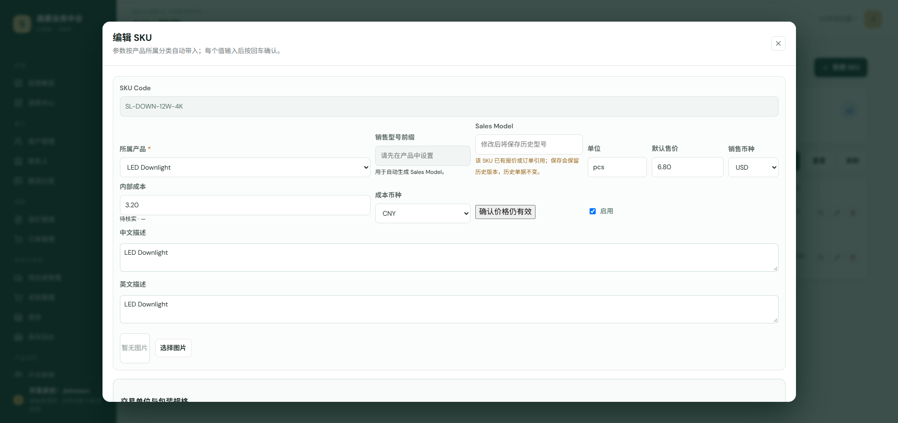
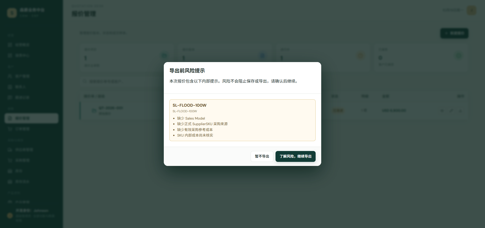

# R1-SKU-01 UAT evidence

本目录记录任务 `R1-SKU-01` 的可复核测试和真实浏览器视觉证据。截图来自当前 feature worktree 的本地服务；交互检查使用真实 Chrome，截图文件使用同一页面和 Google Chrome channel 生成。

## 代码基线

- 分支：`codex/r1-sku-01`
- 开发基线：`origin/master`，拉取时为 `25405e1b25ff8a218b67883acf489ada8a53e146`
- 主工作区未修改；实现位于独立 managed worktree。

## 自动化结果

以下命令均在当前 worktree 实际执行：

| 检查 | 结果 |
| --- | --- |
| `python backend/manage.py check` | 通过：`System check identified no issues (0 silenced).` |
| `python backend/manage.py makemigrations crm --check --dry-run` | 通过：`No changes detected in app 'crm'` |
| `python backend/manage.py test crm.tests.test_sku_cost_verification --verbosity 1` | 通过：7/7 |
| 扩展后端回归（SKU、销售权限、报价、采购成本/安全/计划、履约、库存动作、财务） | 通过：214/214，退出码 0 |
| `npm run test:unit` | 通过：140/140 |
| `npm run build` | 通过；仅保留现有 bundle size warning |
| `npm run test:browser` | 157 个浏览器回归全部通过，退出码 0 |

扩展后端回归的实际命令为：

```text
python backend/manage.py test crm.tests.test_sku_cost_verification crm.tests.test_sales_data_scope crm.tests.test_quote_availability crm.tests.test_quotes crm.tests.test_purchase_costs crm.tests.test_purchase_safety crm.tests.test_procurement crm.tests.test_fulfillment crm.tests.test_inventory_movement_reversal crm.tests.test_finance --verbosity 1
```

## 重点验收证据

### SKU 成本字段和历史未知币种



真实 Chrome 检查了 SKU 编辑页：默认售价和销售币种独立于内部成本和成本币种；已有历史成本币种未知时显示“历史币种未知”，不自动换算。供应商来源表同时显示采购参考价、独立核实状态和“确认价格仍然有效”。

### 报价导出风险提醒



真实 Chrome 检查了报价列表导出入口：一次集中展示涉及 SKU 的风险，不展示采购金额或成本币种；选择“暂不导出”关闭提醒，选择“了解风险，继续导出”后继续原有 Excel 下载流程。

## 兼容和权限说明

- 历史 SKU 的 `cost_currency` 不回填；未知币种保持未知，原成本数值不转换。
- 新建 SKU 默认成本币种为 CNY；销售币种仍由原 `currency` 字段维护。
- 新建订单行保存 `cost_currency_snapshot`；旧订单保持空字符串代表未知，不把旧数据认定为 CNY/USD。
- `risk-preview` 只返回风险代码/文案，不返回成本金额、采购价或采购币种。
- 无采购查看权限的 SKU/SupplierSKU 响应隐藏成本金额、采购价和采购币种；既有销售数据权限回归仍通过。
- 采购价或成本价/对应币种变更会清除核实日期和人员；无关备注、图片不触发清除；90 天只产生提醒，不阻止报价。
- 真实 Chrome 的隔离演示数据库没有登录账号，因此匿名开发身份点击“确认价格仍有效”会被后端按“核实须由已登录员工执行”拒绝；本次 7 个成本测试使用已认证 API 请求验证了服务器时间、核实人员绑定、价格/币种失效和多供应商独立性，并验证了无采购查看权限时的敏感字段脱敏。未为开发人员伪造账号或审计人。

## 尚未覆盖

本次没有改动采购 MOQ、库存辅助采购建议、库存批次、财务统计、采购成本分摊或正式订单利润算法。CI URL 会在分支推送并触发工作流后补入最终报告。
